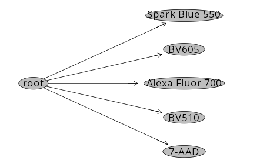

# Background

The original scripts per the README rely on CytoExploreR/commercial software to gate designated positive and negative populations, which then get exported out as .fcs files to designated folders. 

To plug in to this existing workflow, we can modify the existing `flowWorkspace`, `flowGate` and `Luciernaga` steps from [Signature Matrices](https://umgcccfcsr.github.io/CytometryInR/course/SDY3080/SignatureMatrices.html) to carry these steps out. 

# Set Up

Since this is my own contribution, the respective R packages would likely need to be installed. 

```{r}
if (!requireNamespace("flowWorkspace", quietly = TRUE)) BiocManager::install("flowWorkspace")
if (!requireNamespace("Luciernaga",
 quietly = TRUE)) remotes::install_github("https://github.com/DavidRach/Luciernaga")
if (!requireNamespace("flowGate",
 quietly = TRUE)) remotes::install_github("https://github.com/NKInstinct/flowGate")
```

Attach the R packages to your local environment

```{r}
library(flowWorkspace)
library(Luciernaga)
library(flowGate)
library(dplyr)
library(stringr)
```

Identify the .fcs files, load into a GatingSet

```{r}
UnmixingControlsFolder <- file.path("data", "unmixing_controls")
fcs_files <- list.files(UnmixingControlsFolder, pattern=".fcs", full.names=TRUE)
TheCytoset <- load_cytoset_from_fcs(fcs_files, truncate_max_range = FALSE, transformation=FALSE)
TheGatingSet <- GatingSet(TheCytoset)
```

```{r}
TheGatingSet
```

Don't forget to transform with instrument appropiate settings

```{r}
SFC_Parameters <- colnames(TheGatingSet)
FluorophoresOnly <- SFC_Parameters[!stringr::str_detect(SFC_Parameters, "FSC|SSC|Time")]

Biexponential <- flowjo_biexp_trans(channelRange=4096, maxValue=4194304,
  pos=5.62, neg=0, widthBasis=-1000)
MyBiexTransform <- transformerList(FluorophoresOnly, Biexponential)
transform(TheGatingSet, MyBiexTransform)
```

Extract metadata, tidy until you have Fluorophore, Antigen and Type columns

```{r}
pd <- pData(TheGatingSet)

Updated_cell_pd <- pd |> mutate(
    raw = str_extract(name, "(?<=PD_AD_)[^(]+(?=\\()"),
    Antigen = raw |>
      str_trim() |>
      str_extract("^\\S+"),
    Fluorophore = raw |>
      str_trim() |>
      str_remove("^\\S+\\s+") |>
      str_trim(),
    Type = name |>
      str_extract("(?<=\\()([^)]+)(?=\\))"),
    raw = NULL
  )

Updated_cell_pd <- Updated_cell_pd |> 
  mutate(Fluorophore = case_when(
    name == "Unstained (Cells)_scatter.fcs" ~ "CellUnstained",
    TRUE ~ Fluorophore
  ))

Updated_cell_pd <- Updated_cell_pd |>
    relocate(Fluorophore, Antigen, Type, .after="name")

Updated_cell_pd
```

Assign metadata back to GatingSet

```{r}
pData(TheGatingSet) <- Updated_cell_pd
pData(TheGatingSet)
```

Set up Gating Template

```{r}
Template <- pData(TheGatingSet)
Template <- Template |> mutate(Detector="", Negative="CellUnstained")

Template <- Template |> mutate(
    Detector = purrr::map_chr(Fluorophore, \(f) DetectorGuess(x = f, NumberDetectors = 64))
  )

Template
```

Create the initial gates. The borrowed example was downsampled and cleaned at the level of single lymphocytes so set to root, but would have been different here as needed. 

```{r}
#| eval: FALSE

# Run Manually
InitialUnmixSpanGates(template=Template, gs=TheGatingSet, subset="root", minpercentile=0.75, maxpercentile = 0.99)
```

```{r}
#| eval: FALSE

# Run Manually
plot(TheGatingSet)
```



Check the gate placement via the flowGate shiny

```{r}
#| eval: FALSE

# Run Manually
CheckUnmixingSpanGates(template=Template, gs=TheGatingSet, AdjustAll=TRUE)
```

We can then work on exporting the cells that are present within each gate out as their own .fcs file via the Downsampling.R file in the R folder. 

```{r}
TheDownsamplingFunction <- file.path("R", "Downsampling.R")
source(TheDownsamplingFunction)
```

```{r}
NewNames <- Template |> 
  select(Antigen, Fluorophore) |> filter(!Fluorophore %in% "CellUnstained") |>
  mutate(NewName = paste(Antigen, Fluorophore, "pos", sep = "_"))
```

```{r}
# purrr::map2(x=MyGatingSet, subset)
```

# Take Away

At this point, the initial folders needed for this reproducible example have been setup, the minimal .fcs files for the example transferred in, and the neccesary packages present (or retroactively installed). 

# Additional Resources

[]()

```{r}
sessionInfo()
```

